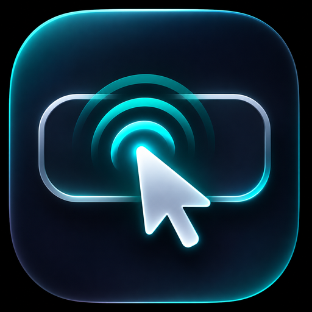

# Haptic Cursor

**Feel the interface without changing it.** A macOS utility that detects when the pointer enters accessible UI controls and triggers a single Force Touch trackpad haptic. No clicking, cursor snapping, highlights, or pointer modification.



> **Developer preview — v3.0.1.** The latest version addresses a main-thread Accessibility crash shown in a previous macOS 27.3 report, but a fully successful run on hardware after the fix has not yet been confirmed. Help test and report issues. The Level 1–4 experimental hardware mode uses Apple's undocumented private MultitouchSupport framework and can break on OS updates. Use Standard mode for the public API fallback.

## Features

- **Haptic on entry:** one feedback request as your pointer enters a supported control, with debouncing to prevent jitter.
- **Accessibility aware:** detects AX roles like `AXButton`, `AXCheckBox`, `AXTextField`, `AXSlider`, `AXScrollBar`, `AXDockItem`, and Finder file/folder entries (best effort across apps and view modes).
- **Haptic profiles:** saved named configurations; duplicate, rename, select, delete, Apply to all, or Set all Off.
- **Per-role settings:** select `Alignment`, `Generic`, or `Level Change` with Off / Levels 1–4.
- **Standard mode:** Apple's three public macOS haptic patterns. All non-Off strength levels have the same physical strength in Standard mode, because the public API does not expose intensity adjustment.
- **Enhanced mode (experimental):** helper process accesses private, undocumented actuator waveforms. Levels are **not calibrated strength percentages** and may be unavailable or unstable.
- **Read-only:** no UI activation, synthetic mouse actions, cursor changes, or visual overlays.
- **Live Accessibility inspector:** inspect the role and application detected under the pointer.

## Live browser demo and documentation

Enable [GitHub Pages](https://docs.github.com/en/pages/getting-started-with-github-pages/configuring-a-publishing-source-for-your-github-pages-site) to publish the `docs/` static site. It includes a visual simulation of pointer entry and profile settings. **Browsers cannot activate the native macOS Force Touch actuator**, so the website is not a hardware demonstration.

## Download and install (macOS)

1. Download [v3.0.1 source + installer ZIP](docs/downloads/MenuMagnetHapticProfiles-v3.0.1.zip) to `~/Downloads`.
2. Install Apple's Command Line Tools if not installed: `xcode-select --install`.
3. Paste this command into Terminal:

```bash
(
  set -e
  ZIP="$HOME/Downloads/MenuMagnetHapticProfiles-v3.0.1.zip"
  TMP="$(mktemp -d)"
  trap 'rm -rf "$TMP"' EXIT
  unzip -q "$ZIP" -d "$TMP"
  bash "$TMP/MenuMagnetHapticProfiles-v3.0.1/install.sh"
  rm -f "$ZIP"
)
```

The GitHub project is branded **Haptic Cursor**. To avoid changing the macOS Accessibility identity during this preview, the installed native app still displays as **Menu Magnet Haptic Profiles** and retains bundle ID `com.menumagnet.hapticprofiles.v2`. This is an intentional naming distinction, not a duplicate application.

The installer **compiles locally** on your Mac, ad-hoc signs the app and helper, checks the install, removes known earlier Menu Magnet apps after a successful build, and requests narrowly targeted resets for **old** app permissions. It may prompt for an administrator password if an older app is in `/Applications`. It never requests a system-wide permission reset. App path: `~/Applications/Menu Magnet Haptic Profiles.app`.

Approve **System Settings → Privacy & Security → Accessibility** if requested. For consistent updates, the v2/v3 bundle ID stays `com.menumagnet.hapticprofiles.v2`. macOS may still prompt for permission again after rebuilding an ad-hoc-signed app. Downloaded binaries from the Internet may be blocked by Gatekeeper; building from source locally is the recommended installation path.

**Requirements:** macOS, a Force Touch trackpad for physical feedback, Apple Command Line Tools. The plist declares macOS 12 as a minimum, but macOS compatibility across releases has not been independently tested. Actual features vary with app Accessibility support and hardware.

## Run checks

The Foundation-only Swift tests can run on any Swift toolchain:

```bash
swiftc Sources/Profiles.swift Tests/ProfileSettingsTests.swift -o /tmp/mm-profiles-test && /tmp/mm-profiles-test
swiftc Sources/EntryLogic.swift Tests/EntryLogicTests.swift -o /tmp/mm-entry-test && /tmp/mm-entry-test
```

A full app compile requires macOS AppKit/SwiftUI. The included `install.sh` performs compilation, signing and startup verification on macOS.

## Architecture

`AXScanner` reads accessible elements beneath the current pointer. `EntryLogic` handles control boundary transitions. `HapticEngine` selects saved per-role settings and triggers one haptic. `Profiles` serializes profile settings. `EnhancedHapticBridge` starts the separate optional private actuator helper. The UI is a normal resizable Dock app (`Window.swift`, `App.swift`).

## Known limitations and safety

- Enhanced Mode relies on undocumented Apple APIs, not guaranteed to be stable or supported. It is **off on each launch**, and the helper is isolated from the UI process.
- The main-thread fix in 3.0.1 addresses a reported `AXUIElementCopyElementAtPosition` / SwiftUI hit-test crash; this fix is not independently hardware-verified.
- Some controls and scrollbars do not expose usable AX geometry; Dock and Finder coverage is best effort.
- Haptic feedback cannot be felt through the website's interactive visual demo.
- This is a community/developer preview. Do not present it as a notarized or Apple-endorsed application.

## Roadmap / contributions

Useful reports include macOS version, hardware/trackpad, whether Standard or Enhanced Mode was enabled, the affected AX role, reproduction steps and crash stack. See [CONTRIBUTING.md](CONTRIBUTING.md). Please remove private filenames, emails or other sensitive content before sharing diagnostics.

## License

[MIT](LICENSE). Apple macOS, SwiftUI, Accessibility and MultitouchSupport are Apple technologies; this project is not affiliated with Apple. The optional private framework is dynamically accessed, not redistributed.

## Publish your own Haptic Cursor repository

To publish from a Mac after downloading the [GitHub-ready package](https://github.com/anshulmahesh/haptic-cursor) (or a local copy):

```bash
gh auth login --web --clipboard
# A one-time code is generated in Terminal and copied to the clipboard.
# Paste it at https://github.com/login/device (no mobile app required).
gh auth status
bash publish.sh
```

`publish.sh` creates a **new public repository named `haptic-cursor`** only after you confirm. It refuses to overwrite an existing repository.
